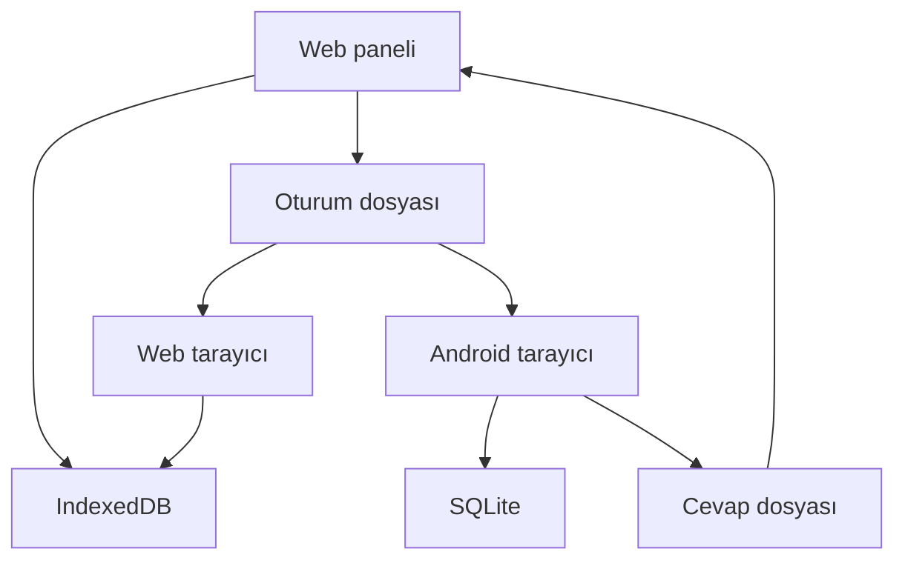

# Hibrit mimari
Öğretmen paneli sınıf, soru ve oturumu yönetir. Kart sözlüğü sürümü oturum açılırken sabitlenir. Panel yalnız öğretmen cihazında isimleri çözümler. Tarayıcıya kart listesi ve anonim oturum/soru kimliği gider. Eski pilotun 5×5 satır kodlaması ayrı kart ailesidir. Aynı basılı kartları yeni sözlükle okumak için bir uyumluluk kanıtı gerekir.

Tarayıcı adaptörü girdi karesini dik ve aynasız görüntüye dönüştürür. Saf yön çözücü, sözlük sırasındaki köşelerden cevabı çıkarır. Oturum takibi her kartı aday, onaylı veya çelişkili olarak izler. Bir kare içindeki çift kimlik ve sınıf dışı kimlik kalıcı kayıt oluşturmaz. Kalıcı yazım başarısızsa aday ekranda onaylıya dönüşmez. Dosya aktarımı önce tüm şemayı, sonra oturum ve sınıf kapsamını denetler. Tek işlem içinde yinelenebilir kayıt gerekir.

web öğretmen ekranı, contracts sürümlü değişim biçimi, android yerel derleme deneyi, reference Python referans ortamıdır. H1'de ilk ekran yalnız cihazdaki çalışma oturumunu açar ve yeniden yükler. Test sırası sözleşme → sentetik piksel → kamera → sınıf pilotudur.
